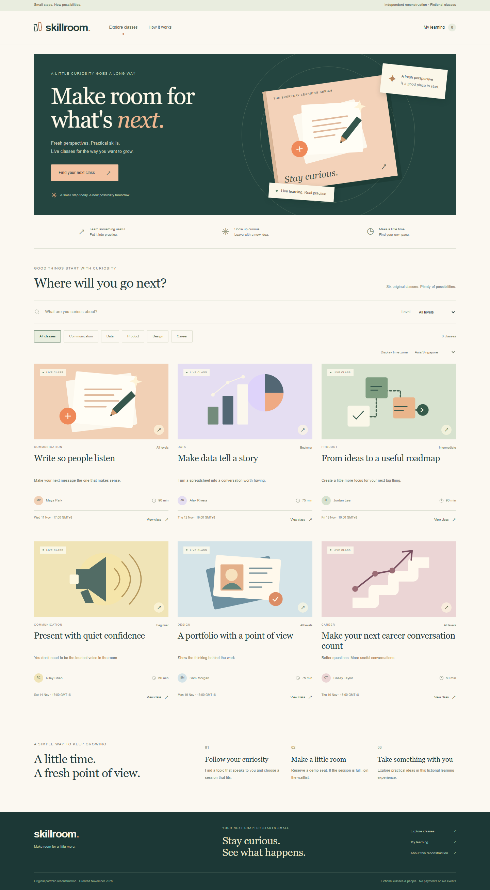

# Skillroom

**Independent learning-platform reconstruction, newly created in November 2026.** Skillroom is an original career-learning demo with fictional classes and instructors. Browse a collection, reserve a session, join a full session's waitlist, and manage your enrollments.



## Context and dates

The supplied resume reports Glints employment from **January 2022 to July 2023**. Glints' [August 30, 2022 company announcement](https://glints.com/sg/inside/glints-raises-usd50m-funding/) names ExpertClass as one of its business segments. An [employer-authored QA vacancy](https://glints.com/sg/opportunities/jobs/qa-engineer-intern-fresh-graduates-remote-possible/05378ff2-879b-4b55-9055-d3914be96661) describes ExpertClass as career learning through webinars, seminars and workshops.

These sources establish company/product context, **not this person's ExpertClass assignment or specific development dates**. Skillroom contains newly authored demonstration code and original illustrations. It is not employer source code, a recovered historical project, or proof of historical contribution. New commits keep their actual creation dates; the resume period is documented context only. The interface and implementation were developed independently rather than copied from Glints.

## What works

- Search and filter six original classes by topic and level.
- Read class outcomes, agendas and fictional instructor profiles.
- View scheduled sessions in Singapore, Tokyo, London, New York or UTC using timezone-aware formatting.
- Reserve seats with server-side capacity checks. Each browser session can hold only one active enrollment per class session.
- Join a full session's FIFO waitlist. Cancelling a confirmed enrollment promotes the earliest remaining waitlisted learner in the same transaction.
- Cancel before a session begins, rejoin at the back of a waitlist, and refresh your current enrollment status.
- Keep enrollment history private to its browser session. API responses do not expose another learner's name, email, session secret or enrollment ID.

All classes, instructors and enrollments are fictional. No payment is collected, no message is emailed, and no real live event occurs. Use a fictional name and an email ending in `.test`.

## Run locally

Requires **Node.js 24+** and npm. SQLite is provided by Node's built-in `node:sqlite` module; there is no external database, API key, font service or asset CDN.

```sh
npm ci
npm run dev
```

Open **http://127.0.0.1:3102**. The database is created automatically at `.data/skillroom.sqlite`, and the seven sessions are dated relative to the first database creation. The first writing session has two seats so the capacity/waitlist behavior can be explored using three separate browser profiles or private browser contexts.

To use a different database, set `SKILLROOM_DB_PATH` in your environment or copy `.env.example` to `.env.local`. Losing the browser cookie loses access to that session's enrollment history; this demo does not include permanent accounts or recovery.

For a fresh demo schedule, stop the server and remove the local `.data` directory. This erases local demo enrollments and generates a new schedule on the next start. Local databases, environment files and dependencies are excluded from source control.

## Validate

```sh
npm test
npm run lint
npm run typecheck
npm run build
npm start
```

The tests exercise final-seat allocation, FIFO promotion, duplicate rejection, rejoining after cancellation, session ownership, invalid input, closed sessions, persistence across database connections, expiration and transaction rollback. GitHub Actions runs tests, lint, TypeScript validation and the production build.

## Implementation

Next.js 16, React 19 and TypeScript serve an original responsive CSS/SVG interface. SQLite persists classes, sessions and enrollments. `BEGIN IMMEDIATE` serializes capacity-changing transactions, and a partial unique index prevents multiple active enrollments for one browser/session pair. Every promotion uses a monotonic queue sequence, so equal timestamps cannot make waitlist ordering ambiguous.

Browser sessions use random 256-bit HttpOnly cookies; the database stores their SHA-256 digests with a 14-day expiry. JSON mutation endpoints reject cross-site origins and non-JSON requests. All enrollment queries and cancellations are scoped to the authenticated demo-session digest. This is a local portfolio demonstration, not a production learning service.

Origin checks use the browser-facing `Host`, rather than Next's potentially different internal hostname. Behind a reverse proxy, configure `SKILLROOM_ORIGIN` with the exact public origin (for example `https://learning.example.test`); forwarded host headers are not trusted automatically. The explicit HTTPS origin also enables secure session cookies.

The scaffold and dependency configuration adapt the author's Hireflow reconstruction under MIT; application workflows, copy and artwork are original to Skillroom. See [LICENSE](LICENSE).
